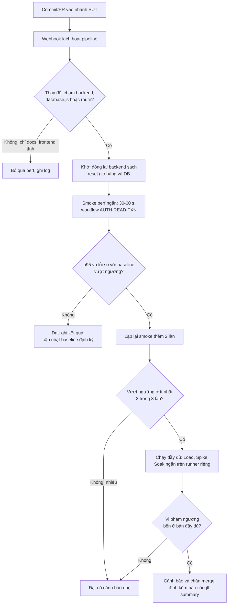

# CPT Proposal – Kiểm thử hiệu năng liên tục (Task 3)

Đề xuất đưa kiểm thử hiệu năng của EShop vào CI. Mọi con số ngưỡng dưới đây dựa trên dữ liệu đo thật của HW05 (localhost, JMeter và SUT chung một máy).

## 1. Luồng đề xuất

## 2. Các bước và ngưỡng

| Bước | Nội dung | Ngưỡng đề xuất | Căn cứ từ HW05 |
|---|---|---|---|
| Lọc thay đổi | Chỉ chạy khi đổi `backend/`, `database.js`, route | Không áp dụng | Chi phí mỗi lần chạy lớn hơn mọi bước kiểm tĩnh |
| Smoke | 30–60 s, tải thấp, workflow cố định | p95 không vượt baseline quá 25%; lỗi ≤ 1% (không tính 401/403 chủ đích) | Cửa sổ ổn định có p95 dao động nhỏ ở tải thấp (spike nền p95 3–5 ms) |
| Lặp lại | Thêm 2 lần khi smoke vi phạm | Chặn khi ≥ 2/3 lần vi phạm | RPS cửa sổ 10 s của stress dao động 1302–1657 (±12%), một lần đo lẻ không đủ tin |
| Chạy đầy đủ | Load, Spike, Soak rút gọn | p95 ≤ 500 ms (stress), ≤ 600 ms ở đỉnh spike, ≤ 10 ms (soak); throughput ≥ 1200 req/s ở stress | Quan sát: p95 tối đa 400 ms, 476 ms, 6 ms |
| Cảnh báo/chặn | Comment vào PR, chặn merge khi vi phạm bản đầy đủ | Không chặn khi chỉ vi phạm smoke một lần | Giảm báo động giả |

Baseline: lấy trung vị p95 của 5 lần chạy gần nhất trên nhánh chính, cập nhật khi PR được merge và hết cảnh báo.

## 3. Đánh đổi chi phí

| Lựa chọn | Lợi ích | Chi phí |
|---|---|---|
| Smoke ở mỗi PR | Phát hiện hồi quy sớm, phản hồi nhanh | Thêm 1–2 phút mỗi PR, cần runner ổn định |
| Chạy đầy đủ ở mọi PR | Bao phủ cao | Lượt đầy đủ của HW05 kéo dài hàng chục phút (soak ~15 phút); quá đắt |
| Chạy đầy đủ theo đêm hoặc khi nghi ngờ | Cân bằng chi phí | Hồi quy nhỏ có thể lọt qua một đêm |
| Ngưỡng chặt | Bắt được hồi quy nhỏ | Nhiều báo động giả |
| Ngưỡng lỏng | Ít làm phiền | Bỏ sót; ngưỡng 1000 ms của script hiện tại không bắt được gì trong dữ liệu đã đo |

## 4. Báo động giả và nhiễu môi trường

- **Lượng tử hóa p95:** soak có p95 chỉ 3–6 ms với độ phân giải 1 ms, nên chênh 1–2 ms là nhiễu. Soak nên so sánh theo tỉ lệ nhiều lần đo, không theo một cửa sổ.
- **Máy dùng chung:** JMeter và SUT chạy cùng một máy nên tranh CPU; thông lượng stress bão hòa quanh 1400–1500 req/s có thể bị ảnh hưởng bởi JMeter. Giải pháp: runner riêng cho SUT, hoặc tách JMeter sang máy khác, và ghi cấu hình máy vào báo cáo.
- **Trạng thái SUT:** giỏ hàng nằm trong bộ nhớ và `initDatabase()` xóa bảng khi khởi động, nên mỗi lượt phải khởi động lại backend để có trạng thái giống nhau; bảng `orders` tăng dần trong lượt chạy.
- **Khởi động lạnh:** loại giai đoạn ramp và vài giây đầu khỏi phép so sánh.
- **Giảm báo động giả:** lặp 2/3, so sánh với trung vị baseline thay vì một lần đo, tách lỗi 401/403 chủ đích, và ghi rõ môi trường.

## 5. Giới hạn

Đề xuất chưa được triển khai và chưa đo trên CI thật. Các ngưỡng chỉ có giá trị cho môi trường localhost này, cần hiệu chỉnh lại trên runner thật.
